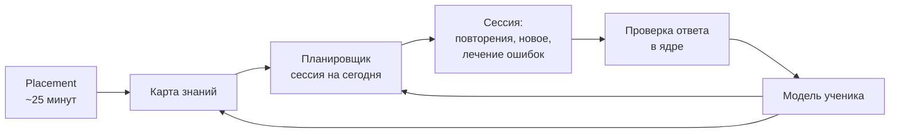
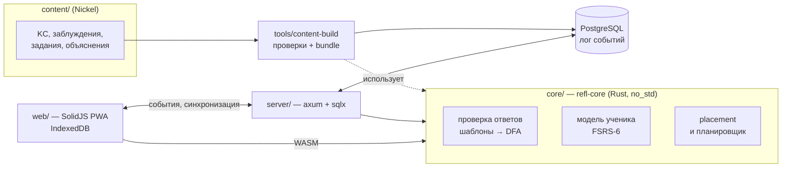

# refl

refl — платформа изучения английского от нуля до C1: общий английский и формат IELTS. Сайт — [refl.uz](https://refl.uz). Родной язык ученика — узбекский или русский, интерфейс и объяснения на uz / ru / en.

refl не раздаёт очки за активность. Он строит модель того, что ученик знает, что забывает, что делает медленно и в чём ошибается системно, и по этой модели собирает каждое занятие. Каждое решение системы можно объяснить: «почему это задание» — не маркетинг, а формула.

> **Статус: этап 0 — фундамент.** Готовы ядро (типы домена, проверка ответов), сборка и проверка контента, схема базы данных и лог событий. Интерфейса для учеников пока нет. Всё, что ниже описано как возможности, — спецификация, по которой идёт разработка; что уже сделано, видно в разделе [«Этапы»](#этапы).

## Содержание

- [Для кого](#для-кого)
- [Как refl учит](#как-refl-учит)
- [Модель ученика](#модель-ученика)
- [Контент](#контент)
- [Интерфейс](#интерфейс)
- [Мотивация без давления](#мотивация-без-давления)
- [Социальные функции и безопасность](#социальные-функции-и-безопасность)
- [Архитектура](#архитектура)
- [Структура репозитория](#структура-репозитория)
- [Стек](#стек)
- [Разработка](#разработка)
- [Этапы](#этапы)
- [Спецификации](#спецификации)

## Для кого

- **Ученики 8–20+ лет**, от абсолютного нуля до C1. Дети учатся под присмотром взрослого: у их аккаунтов отдельные правила приватности.
- **Те, кто готовится к IELTS.** Сначала сильный общий английский, потом формат экзамена: моки с таймингом и прогноз band с интервалом.
- **Менторы** — родитель, учитель, старший брат или сестра. Видят карту знаний и слабые места своих учеников, проверяют письмо, получают сводки.

refl — не «10 минут в день». Это полноценные занятия: глубокие объяснения, задания на производство (ученик сам пишет ответ, а не только выбирает), письмо и слух.

## Как refl учит



**1. Placement.** Вместо одной буквы CEFR — стартовое состояние модели: оценка по каждой теме, словарный запас и уровень по навыкам. Четыре этапа от грубого к точному: общий уровень (якорные задания), словарный запас, диагностика тем в окне уровня, reading и listening. Около 25 минут, не больше 40 заданий; начинающий с нуля выходит через 3–4 задания без непосильных вопросов. Уровни тем и слов опираются на English Grammar Profile и English Vocabulary Profile (Cambridge).

**2. Планировщик.** Сравнивает все возможные действия по одной шкале — ценность на минуту:

- **учить** — дыра или новая тема; учитывает важность, готовность пререквизитов (Present Perfect не дают тому, кто не владеет Past Simple), активные заблуждения и то, сколько тем ждёт эту как фундамент;
- **повторить** — память опустилась ниже 90% или скоро опустится.

Сессия собирается как задача о рюкзаке в бюджет времени с педагогическими ограничениями: повторения 15–35%, новое, лечение заблуждений, смешивание тем. Выбор следующего задания идёт на устройстве, поэтому работает офлайн. Блок 25 минут = одна сессия (помодоро встроен).

**3. Задания** идут по лестнице: узнавание → управляемое производство → свободное производство. Тема не считается освоенной по одним выборам вариантов: узнавание систематически переоценивает знание.

| Тип | Уровень |
| --- | --- |
| Выбор варианта, поиск ошибки, сопоставление, True / False / Not Given | узнавание |
| Ввод в пропуск, трансформация («перепиши, используя since»), сборка предложения, перевод uz/ru → en, диктант | управляемое производство |
| Своё предложение по заданию, письмо и эссе, IELTS Writing Task 1/2 | свободное производство |

Reading и listening — «пассажи»: текст или аудио с вложенными заданиями любого типа. IELTS-секция — тот же пассаж с жёстким таймингом и пересчётом в band.

**4. Уверенность.** Перед ответом ученик отмечает «уверен / сомневаюсь». Уверенная ошибка — сильный сигнал заблуждения; угаданный верный ответ — слабое свидетельство знания.

**5. Обратная связь — диагноз, а не «неверно».** Каждый дистрактор и шаблон ошибки привязан к конкретному заблуждению. Ответ «I live here since 2019» не просто «ошибка»: это «Present Simple вместо Present Perfect с since», и система покажет контрастное объяснение и подберёт задания-лекарства. Опечатка не наказывает грамматику: она идёт в тему орфографии, а целевая тема засчитывается.

**6. Объяснения** — короткое, «почему» и глубокое. Контраст с родным языком пишется отдельно для узбекского и русского (это разные тексты, а не перевод). С B2 объяснения по умолчанию на английском, родной — по нажатию.

**7. «Почему это задание».** Объяснение берётся из той же формулы, которая выбрала задание: «Повторяем X: без повторения через 3 дня вероятность вспомнить упадёт ниже 90%», «Ошибки в Y, похоже, идут от X — проверим X», «Ты 4 раза путал … — это задание как раз на это».

**8. Долгосрочный план.** Дата экзамена → нагрузка по неделям с учётом слабых мест; прогноз IELTS band — только диапазоном и только когда хватает данных.

### По навыкам

| Навык | Что будет |
| --- | --- |
| Грамматика | граф тем A1–C1, уроки, задания с вводом, тетрадь ошибок |
| Лексика | модель по значениям слов (не по словам), FSRS для каждого значения, личный словарь: слово из текста вместе с предложением сразу уходит в повторения |
| Reading | открытая библиотека по уровням, тексты с персональным лексическим покрытием, клик по слову → карточка |
| Listening | своё аудио (оригинальные сценарии + локальный TTS), плеер с циклом «смысл → детали → текст → интенсив», синхронная подсветка слов, диктант с классификацией ошибок (слабые формы, связки), shadowing |
| Writing | свободные ответы, метрики (длина, связки, разнообразие), Hunspell и локальный LanguageTool, чеклист по критериям IELTS, образец, ревью ментором |
| Speaking | измерительные инструменты, а не чат-бот: произношение по звукам, интонация и ритм (DSP прямо на устройстве), беглость, лексика и грамматика речи — локальные модели (whisper.cpp, ONNX) в асинхронной очереди |

## Модель ученика

Модель — чистая функция `fold(state, event) → state` в Rust-ядре. По каждой единице знания она хранит четыре независимые величины и предсказывает ответ на любое задание до того, как ученик его увидит.

| Величина | Что означает | Как лечится, если плохо |
| --- | --- | --- |
| Знание μ, σ | насколько ученик владеет правилом и насколько система в этом уверена | объяснение и задания |
| Память S, D, R (FSRS-6) | стабильность, сложность, вероятность вспомнить сейчас | повторение |
| Автоматизм τ | насколько быстро верный ответ (логнормальная модель времени) | тренировка скорости |
| Заблуждения α, β | сила каждой неверной идеи и надёжность оценки | контрастные задания |

«Не знает», «забыл», «знает, но медленно» и «знает, но держится за неверную идею» — четыре разных состояния, и лечатся они по-разному.

Память по FSRS-6: R(t) = (1 + F·t/S)^(−w₂₀), F = 0,9^(−1/w₂₀) − 1. Забывание временно снижает навык в прогнозе, повторение его возвращает.

**Тема освоена**, когда одновременно: вероятность, что навык выше порога, ≥ 0,8; автоматизм не ниже нормы; минимум два верных ответа на заданиях с вводом или свободным ответом.

**Модель проверяет себя:** прогноз считается до показа задания, и калибровка «прогноз против факта» видна ученику во вкладке «Модель» статистики. Новую модель можно запустить «в тени» рядом со старой (трейт `LearnerModel`) и сравнить на реальном логе.

## Контент

Контент — это код: всё лежит в git, пишется на [Nickel](https://nickel-lang.org) и проходит `content-build` на каждый коммит.

**Единица знания (KC)** — маленькое проверяемое правило со связями «требует» и «часть темы». Граф тем — основа карты знаний и планировщика. Лексика моделируется отдельно: значение слова с частотным рангом, формами и аудио, через FSRS, а не через граф.

**Заблуждение** — именованная неверная идея (с происхождением: перенос из родного языка, сверхобобщение…) с темой-лекарством.

**Семья заданий** — одна конструкция в 40–60 вариантах: при повторении ученик получает другого члена семьи, и система проверяет правило, а не память на конкретное предложение.

**Язык шаблонов ответов.** Допустимые и ошибочные ответы описываются компактно и компилируются в автомат:

```
I have (lived|been living) here since 2019 [.]
(a|an) apple
```

Альтернативы `( | )`, необязательное `[ ]`, вложенность до 4, без повторений — язык всегда конечен. Нормализация (регистр, пробелы, апострофы, однозначные сокращения) версионирована и живёт в ядре — одна реализация для сборки и для проверки у ученика.

**Что проверяет content-build:**

- схема и ссылки (KC, заблуждения, объяснения, аудио);
- граф без циклов пререквизитов;
- у задания есть primary KC, достаточно дистракторов и шаблонов ошибок, у каждого — привязка к заблуждению;
- верный ответ принимается, дистракторы не принимаются;
- шаблоны «верно» и «ошибка» не пересекаются — проверяется точным произведением автоматов, с кратчайшим примером-свидетелем в отчёте;
- статус темы (live / draft) вычисляется: live — только если есть объяснение на ru и en, не меньше 10 заданий, 3 семей, 3 заданий на производство и разброс сложности на два соседних уровня.

Результат — детерминированный bundle; версия контента — SHA-256 его содержимого. Если автор потом добавит ответ в допустимые, старые события не меняются: сервер пишет `reclassified`, и модель пересчитывается.

## Интерфейс

**Дизайн-код «Живая Студия»** (docs/08): серьёзная структура рабочего инструмента — боковая панель, поиск ⌘K, плотные данные — и живое ощущение учебной платформы: иллюстрированные сцены, «объёмные» кнопки и плитки, данные, которые прорисовываются при открытии. Один иллюстрированный блок на экран, остальное — спокойно. Телефон — первым: одна колонка, крупные зоны нажатия, плавающая панель вкладок.

| Экран | Что на нём |
| --- | --- |
| Сегодня | маршрут занятия по сцене (остановки: пройдено, сейчас, впереди), навыки, память, прогноз |
| Занятие | одно главное действие, «уверен / сомневаюсь», диагноз после ответа |
| Карта знаний | граф тем, раскрашенный по состоянию |
| Статистика | итог месяца и «Расширенно»: навыки, память, словарь, ошибки, время, честность модели (docs/09) |
| Тетрадь ошибок | собирается сама: ошибка, исправление, правило, статус заблуждения |
| Заметки | markdown со ссылками `[[…]]`, привязка к теме, слову или тексту, граф заметок поверх карты знаний |
| Библиотека | открытые тексты по уровням |
| Профиль | анимированный фон, аватар в рамке, титул, ачивки, карточки, подарки |

**Темы** — пакеты данных: токены, иллюстрации по слотам, звуки, облик компаньонов. Новая тема или переделка дизайна не трогает код экранов. Три темы есть у всех: «Живая Студия», «Мир» (пиксельный архипелаг, по умолчанию детям) и строгая «Студия»; светлая и тёмная схема — по системе.

**Компаньоны** (docs/06) — пиксельные персонажи со своей историей: **Iella**, ласточка-почтальон, и **Sendo**, хранитель библиотеки. Сюжет движется только от реальных вех (уровень, закрытые темы), не от серии и не от времени в приложении. Компаньон никогда не упрекает и не давит, во время ответа неподвижен.

**Первый вход** — пять шагов поверх настоящего интерфейса, ведёт компаньон; пропускается, повторяется из настроек.

**Доступность:** контраст WCAG AA в каждой теме, «верно / неверно» не только цветом, уважение к «уменьшить движение», шрифты с полной кириллицей, узбекской латиницей (oʻ, gʻ) и IPA.

## Мотивация без давления

Всё строится на одной модели разблокировок и на том же логе событий (docs/07).

- **Ачивки** — только за результат: освоенные темы, вылеченные заблуждения, долгая память, прочитанные тексты. До шести ступеней (I–VI) с прогрессом «осталось N до IV». Секретные — реальное условие, которое не раскрывается. Уникальные — первому в команде.
- **Косметика профиля** — пять слотов: аватар, рамка, анимированный фон, титул, эффект. Редкость — от обычной до легендарной, но это трудность условия, а не шанс выпадения. «Примерочная» показывает любой предмет и как его получить.
- **Рамки ступеней** растут с уровнем: Росток → Луговой венок → Иней → Сумеречный лавр → Аметистовые крылья → Солнечный венец — и никогда не понижаются.
- **Карточки:** одна карточка — одна закрытая тема; редкость = уровень темы; на обороте правило, твой пример и вылеченная ошибка.
- **Подарки** — открытки друзьям к их вехам.
- **Серия дней с заморозкой:** один пропуск её не обнуляет.

**Чего нет намеренно:** внутренней валюты и магазина, наград за ежедневный вход, XP-уровней и рейтингов, ачивок за время, наборов и случайных выпадений, обмена карточками.

## Социальные функции и безопасность

- **Команды** по ссылке-приглашению или публичному коду, общие цели вместо рейтинга; владелец команды может быть ментором.
- **Друзья** по коду или из команды; чат в реальном времени — команды и личные между взаимными друзьями; в сообщение можно вложить задание, слово или заметку живой карточкой.
- **Telegram-бот:** напоминание, когда накопились повторения, итог дня, уведомления ментору, вход через Telegram.
- **Профиль** показывает уровень, косметику, витрину ачивок и карточек, подарки. Статистика, серия, ошибки и заметки не видны никому, кроме ученика и его ментора.
- **Дети:** аккаунт создаёт взрослый, который становится опекуном; профиль по умолчанию закрыт; личных сообщений нет, общение только в чате команды; подарки — только внутри команды и без текста. Дата рождения не хранится.
- **Вход** по одноразовому коду на почту или через Telegram; паролей нет.
- **Удаление:** данные ученика стираются по запросу отдельной процедурой с отдельной ролью в базе.

## Архитектура



Вся логика обучения живёт в одном ядре на Rust. Сервер вызывает его нативно, PWA — через WASM, поэтому проверка ответов и модель ученика работают без интернета и считают одинаково.

**Принципы** (полностью — в [CLAUDE.md](CLAUDE.md) и [docs/01](docs/01-architecture.md)):

1. **Лог событий — единственный источник правды.** Только дописывается; у события есть `schema_version`, старые форматы читаются через upcasters. Ошибки исправляются новыми событиями (`reclassified`), а не правкой старых. Снапшоты модели — только ускорение, их можно удалить и пересчитать.
2. **Ядро чистое и детерминированное.** Без ввода-вывода, часов и случайности (время приходит аргументом); float-математика только через `libm`, в состоянии только упорядоченные структуры. Нативная сборка и WASM дают бит-в-бит одинаковое состояние — тест сравнивает хэши.
3. **Offline-first.** События создаются на клиенте с UUIDv7 и лежат в IndexedDB до синхронизации; синхронизация идемпотентна, конфликтов нет: лог только растёт.
4. **Производные события пишет сервер.** Вехи, ачивки и разблокировки вычисляются из лога ядром и фиксируются сервером с уникальным ключом, поэтому пересчёт идемпотентен. Офлайн клиент празднует сразу по своей свёртке — вычисление то же самое.
5. **Контент как код**, проверка ответов без внешних ИИ-сервисов.
6. **Расширяемость через трейты:** `ItemKind` (схема и проверка типа задания; отрисовка — компонент в реестре клиента на сгенерированных TS-типах) и `LearnerModel`.
7. **Производительность закладывается при сборке контента:** замыкание графа, автоматы шаблонов, индексы — а не в рантайме.
8. **Монолит на одном сервере.** Микросервисы, брокеры сообщений и многосерверность намеренно отложены; чат, уведомления и прогресс команды идут по одному WebSocket.

**Данные в PostgreSQL** (миграции в `server/migrations`):

| Что | Как |
| --- | --- |
| лог событий | append-only, изменение и удаление запрещены триггерами; роль приложения может только дописывать |
| снапшоты модели | ускорение свёртки, привязаны к версии модели и весов |
| пользователи, вход, роли | learner, mentor, author, admin; флаг ребёнка; способы входа отдельной таблицей |
| соцграф и приватность | команды, друзья, блокировки, жалобы, публичные коды, `profile_visibility` |
| уведомления | каналы (Telegram, push, почта), настройки по паре (вид, канал), outbox |
| контент | таблицы по версии контента, идемпотентный импорт bundle |
| удаление | отдельная роль и процедура стирания данных ученика |

## Структура репозитория

| Путь | Что там |
| --- | --- |
| `core/` | `refl-core` — типы домена, события, нормализация, язык шаблонов, DFA, модель разблокировок. `no_std` + `alloc`; фича `std` — для тестов и инструментов, `ts` — для генерации TS-типов |
| `server/` | `refl-server` — миграции, запись событий, импорт bundle, тесты на временном PostgreSQL. HTTP — с этапа 1 |
| `tools/content-build/` | CLI сборки и проверки контента; тестовые фикстуры на каждую проверку |
| `content/` | контент на Nickel: схема (`lib/`) и пример темы «Артикли» (`articles/`) |
| `web/` | клиент; сейчас — сгенерированные из Rust TS-типы в `web/src/generated/core/` |
| `docs/` | спецификации — единственный источник правды по решениям |
| `flake.nix`, `justfile` | окружение, сборка и CI |

## Стек

| Часть | Выбор |
| --- | --- |
| Ядро | Rust (версия в `rust-toolchain.toml`), нативно и `wasm32-unknown-unknown` |
| Сервер | axum + tokio, sqlx, PostgreSQL |
| Клиент | TypeScript + SolidJS + Vite, PWA, IndexedDB; типы из Rust (ts-rs) |
| Контент | Nickel → `content-build` на Rust |
| Память | FSRS-6 в ядре; fsrs-rs — только офлайн, для подбора весов |
| Аудио | оригинальные сценарии → Piper / Kokoro → Opus; Montreal Forced Aligner для времени слов; отдаёт nginx |
| Письмо | Hunspell, локальный LanguageTool |
| Speaking | DSP в ядре, whisper.cpp (whisper-rs), ONNX Runtime; очередь — таблица в Postgres |
| i18n | Fluent (uz / ru / en, правильные склонения чисел) |
| Наблюдаемость | tracing, Prometheus, Grafana; метрики качества модели |
| Бэкапы | pgBackRest, архивация WAL |
| Сборка и деплой | Nix flake (fenix + crane), модуль NixOS, systemd |

## Разработка

Нужен Nix с включёнными flakes; всё остальное приходит из окружения. С direnv окружение подхватывается само (`.envrc`).

```sh
nix develop        # Rust, sqlx-cli, PostgreSQL, Nickel, Node, just
just               # fmt-check, clippy, тесты, wasm32-сборка ядра, content-build
just --list        # рецепты по отдельности
just ci            # полный герметичный CI = nix flake check
```

| Рецепт | Что делает |
| --- | --- |
| `just fmt` / `just fmt-check` | форматирование / проверка |
| `just lint` | clippy с `-D warnings` |
| `just test` | все тесты, включая базу (временный PostgreSQL) и свежесть TS-типов |
| `just wasm` | сборка ядра под браузер |
| `just content` | проверка `content/`, bundle в `target/bundle.json` |
| `just bindings` | перегенерировать TS-типы после изменения типов ядра (результат коммитится) |

Тесты сервера сами поднимают одноразовый кластер PostgreSQL (`initdb` во временном каталоге), системная база не нужна.

**Как добавить:**

- **тему контента** — файлы Nickel в `content/<тема>/`: KC, заблуждения, объяснения, задания с шаблонами; `just content` покажет отчёт и статус live / draft;
- **тип задания** — реализация `ItemKind` в ядре (схема + проверка) и компонент отрисовки в реестре клиента;
- **ачивку** — контент на существующем предикате ядра; новая ачивка выдаётся задним числом всем, кто её заслужил;
- **тему оформления** — пакет данных по схеме слотов (docs/08), без кода.

**Правила** (подробно — [CLAUDE.md](CLAUDE.md)):

- спека правится раньше кода, с обоснованием в коммите; решения, которых нет в спеке, не принимаются молча;
- коммиты маленькие, по одному смыслу, на английском;
- никаких временных обходов и хаков — если не ложится в архитектуру, правится архитектура;
- любое изменение модели ученика — через регрессию на симуляторе и сравнение лог-лосса;
- секреты не коммитятся.

## Этапы

У каждого этапа есть измеримый критерий перехода. Польза начинается после этапа 1, а не в конце.

| Этап | Что входит | Статус |
| --- | --- | --- |
| 0. Фундамент | монорепо, Nix flake, CI; типы домена; content-build с проверками; схема БД и лог событий | идёт: 0.1–0.3 готовы |
| 1. Ядро обучения | типы заданий, конвейер проверки, модель ученика v1 + FSRS, уроки, PWA с офлайном, Telegram-бот; грамматика A1–A2 (~60 KC) | — |
| 2. Placement и планировщик | адаптивный placement, планировщик, карта знаний, «почему это задание», ментор, команды и друзья, тетрадь ошибок; до B1 (~120 KC) | — |
| 3. Лексика, reading, библиотека | модель лексики, FSRS для слов, тексты, личный словарь, заметки с графом, ачивки, косметика, карточки | — |
| 4. Listening | аудио-конвейер, плеер, диктант с классификацией ошибок, shadowing | — |
| 5. Writing | свободные ответы, LanguageTool, чеклисты критериев, ревью ментором | — |
| 6. IELTS | полные моки с таймингом, пересчёт в band, прогноз с интервалом; B2–C1 | — |
| 7. Speaking | интонация и ритм через DSP, затем оценка произношения | — |

## Спецификации

| Файл | О чём |
| --- | --- |
| [01-architecture](docs/01-architecture.md) | архитектура, фундамент, стек, этапы, социальные функции, пользователи и соцграф |
| [02-layer1-content](docs/02-layer1-content.md) | KC, граф, заблуждения, задания, язык шаблонов ответов, объяснения, уроки, события, версии |
| [03-layer2-learner-model](docs/03-layer2-learner-model.md) | модель ученика: знание, FSRS-6, автоматизм, заблуждения, освоение, самопроверка |
| [04-placement-planner](docs/04-placement-planner.md) | placement и планировщик сессий, «почему это задание» |
| [05-audio-player-speaking](docs/05-audio-player-speaking.md) | аудио-конвейер, плеер, диктант, speaking |
| [06-companions](docs/06-companions.md) | компаньоны Iella и Sendo, главы по вехам, приватность |
| [07-themes-achievements-frames](docs/07-themes-achievements-frames.md) | темы, ачивки, косметика, карточки, подарки, профиль |
| [08-design](docs/08-design.md) | дизайн-код «Живая Студия», темы как пакеты данных, движение, первый вход |
| [09-stats](docs/09-stats.md) | статистика и откуда берётся каждое число |
