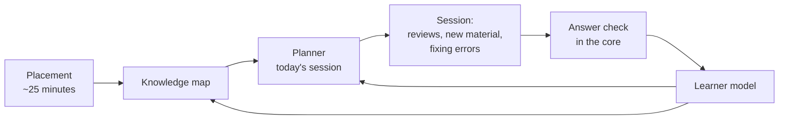
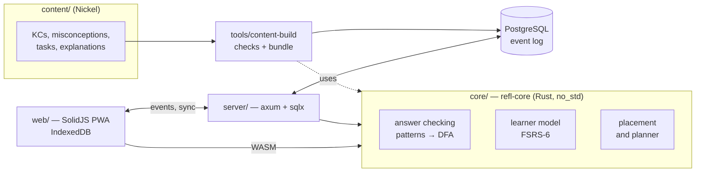

# refl

refl is a platform for learning English from zero to C1: general English and the IELTS format. Website: [refl.uz](https://refl.uz). Learners' native language is Uzbek or Russian; the interface and explanations are in Uzbek, Russian and English.

English is the first subject. From day one the core is built with a boundary between a shared engine (knowledge graph, learner model, planner, event log) and the subject, so **mathematics** (school curriculum, then university) and **Japanese** come next as separate tracks after stage 2 ([docs/10](docs/10-subjects.md)).

refl does not hand out points for activity. It builds a model of what the learner knows, what they are forgetting, what they do slowly and where they make systematic mistakes, and it assembles every session from that model. Every decision the system makes can be explained: "why this task" is not marketing, it is a formula.

> **Status: stage 0, foundation.** The core (domain types, answer checking, the full schema-1 event set, decoding of events from newer clients), content build and validation, database schema and event log are done. There is no learner-facing interface yet. Everything described below as a feature is the specification development follows; what is already built is listed under [Stages](#stages).
>
> The specifications in [`docs/`](docs/README.md) are written in Russian and are the single source of truth. This README is their English overview.

## Philosophy

refl is a personal learning system built as open educational infrastructure. The learner is at the centre: their knowledge, gaps and goals. Success is measured by how well a person learns to understand and apply things alone, so refl should make them less dependent on refl.

- The learner sets goals; the system proposes and explains, and never forces a route.
- Basic learning is free. Money comes from organisations, grants and donations, never from ads, data or paid shortcuts.
- Learning works offline; the network is for sync, updates and chat.
- The code is open (AGPL-3.0-only) and the formats are documented; anyone can build their own content on the same infrastructure.
- No AI as a source of truth: the core is deterministic and checkable.
- Not here: rankings, endless rewards, a score for a person's worth, forced routes. Full text and maturity criteria: [docs/00](docs/00-philosophy.md).

## Contents

- [Philosophy](#philosophy)
- [What is our own](#what-is-our-own)
- [Who it is for](#who-it-is-for)
- [How refl teaches](#how-refl-teaches)
- [Method](#method)
- [Learner model](#learner-model)
- [Quality control](#quality-control)
- [Other subjects](#other-subjects)
- [Content](#content)
- [Interface](#interface)
- [Motivation without pressure](#motivation-without-pressure)
- [Social features and safety](#social-features-and-safety)
- [Privacy](#privacy)
- [Architecture](#architecture)
- [Repository layout](#repository-layout)
- [Stack](#stack)
- [Development](#development)
- [Stages](#stages)
- [Specifications](#specifications)
- [License](#license)

## What is our own

| Part | What it is | Where |
| --- | --- | --- |
| Deterministic learning core | answer checking, learner model, placement and planner: one Rust implementation, bit-for-bit identical on the server and offline in the browser; no AI at runtime | [docs/01](docs/01-architecture.md) |
| Learner state model | assembled from proven parts (IRT-style Bayesian skill estimates, FSRS-6, a lognormal response-time model, beta estimates of misconceptions, graph propagation from knowledge space theory); what is ours is how they are combined: eight topic states and learner traits, each with its own remedy | [docs/03](docs/03-layer2-learner-model.md) |
| System quality control | not only content is checked, but also predictions, diagnoses, plans and real outcomes, via audit items | [docs/11](docs/11-quality.md) |
| Content compiler with formal checks | answer patterns compile to automata; that accepted and error patterns never overlap is proven with an automaton product, not tested on examples | [docs/02](docs/02-layer1-content.md) |
| Our own method | the "from reflection to reflex" cycle built from the techniques with the strongest evidence | [docs/12](docs/12-method.md) |
| Multi-subject core | English, then mathematics and Japanese on the same model and planner | [docs/10](docs/10-subjects.md) |
| Reproducible log | offline-first event log; any model state and any planner decision can be replayed and checked after the fact | [docs/02](docs/02-layer1-content.md), [docs/11](docs/11-quality.md) |

## Who it is for

- **Learners aged 8–20+**, from absolute zero to C1. Children learn under an adult's supervision; their accounts follow separate privacy rules.
- **IELTS candidates.** Strong general English first, then the exam format: timed mocks and a band forecast with an interval.
- **Mentors**: a parent, teacher, older brother or sister. They see their learners' knowledge map and weak spots, review writing, and get summaries.

refl is not "10 minutes a day". These are full sessions: deep explanations, production tasks (the learner writes the answer rather than only choosing), writing and listening.

## How refl teaches



**1. Placement.** Instead of a single CEFR letter, the starting state of the model: an estimate for every topic, vocabulary size and level per skill. Four steps from coarse to fine: overall level (anchor items), vocabulary, topic diagnosis within the level window, reading and listening. About 25 minutes and at most 40 items; a complete beginner exits after 3–4 items without impossible questions. Topic and word levels rely on the English Grammar Profile and English Vocabulary Profile (Cambridge).

**Level is not a letter.** CEFR borders are conventional, and the road from B1 to B2 is long. refl shows a continuous position with an interval and a per-skill profile: "B1 · 40% of the way to B2 (likely 25–55%)", with grammar, vocabulary, reading and listening shown separately, the "I can …" descriptors already covered, and what would move the learner forward most. The position is the sum of importance-weighted level coverages, so it does not jump at borders, and gaps at lower levels honestly pull it down ([docs/04](docs/04-placement-planner.md)).

**A break lowers the level.** Level is computed from what the learner knows now, with per-topic forgetting, so after a break it drops and its interval widens. There is no calendar threshold: well-learned material lasts long, recently learned material lasts days (research shows retention depends mostly on how well something was learned, and production fades faster than recognition). When the model sees noticeable forgetting (or after 14 days), the first session starts with a short production-first return check: what is recalled gets stronger than usual, what is forgotten goes into reviews before anything new. After 90 days the check is broader; after a year a new placement is offered ([docs/03](docs/03-layer2-learner-model.md), [docs/04](docs/04-placement-planner.md)).

**2. Planner.** Compares every possible action on one scale, value per minute:

- **learn**: a gap or a new topic; accounts for importance, prerequisite readiness (no Present Perfect for someone who doesn't have Past Simple), active misconceptions and how many topics wait on this one;
- **review**: memory has dropped below 90% or is about to.

A session is built as a knapsack problem within a time budget under pedagogical constraints: 15–35% reviews, new material, fixing misconceptions, mixing topics. The next item is chosen on the device, so it works offline. A 25-minute block is one session (pomodoro built in).

**3. Tasks** follow a ladder: recognition → guided production → free production. A topic is never considered mastered from multiple choice alone: recognition systematically overestimates knowledge.

| Type | Level |
| --- | --- |
| Multiple choice, find the error, matching, True / False / Not Given | recognition |
| Gap fill, transformation ("rewrite using since"), sentence assembly, translation uz/ru → en, dictation | guided production |
| Own sentence on a prompt, letters and essays, IELTS Writing Task 1/2 | free production |

Reading and listening are "passages": a text or audio with embedded tasks of any type. An IELTS section is the same passage with strict timing and conversion to a band.

**4. Confidence.** Before answering, the learner marks "sure / not sure". A confident error is a strong signal of a misconception; a lucky correct answer is weak evidence of knowledge.

**5. Feedback is a diagnosis, not "wrong".** Every distractor and error pattern is tied to a specific misconception. "I live here since 2019" is not just "an error": it is "Present Simple instead of Present Perfect with since", and the system shows a contrastive explanation and picks remedial tasks. A typo does not penalise grammar: it goes to the spelling topic, and the target topic counts as passed.

**6. Explanations** come in three depths: short, "why" and deep. The contrast with the native language is written separately for Uzbek and Russian (different texts, not translations). From B2, explanations default to English, with the native language one tap away.

**7. "Why this task".** The explanation comes from the same formula that chose the task: "Reviewing X: without a review, in 3 days the chance of recalling it drops below 90%", "Errors in Y seem to come from X; let's check X", "You've confused … 4 times; this task is exactly about that".

**8. Long-term plan.** Exam date → weekly load accounting for weak spots; the IELTS band forecast is only shown as a range and only when there is enough data.

### By skill

| Skill | What it will include |
| --- | --- |
| Grammar | A1–C1 topic graph, lessons, typed-answer tasks, error notebook |
| Vocabulary | a model by word senses (not words), FSRS for every sense, a personal dictionary: a word from a text goes into reviews together with its sentence |
| Reading | an open library by level, texts with personal vocabulary coverage, tap a word → card |
| Listening | our own audio (original scripts + local TTS), a player with a "gist → details → text → intensive" cycle, synchronised word highlighting, dictation with error classification (weak forms, linking), shadowing |
| Writing | free answers, metrics (length, linkers, variety), Hunspell and a local LanguageTool, an IELTS criteria checklist, a model answer, mentor review |
| Speaking | measuring instruments, not a chatbot: pronunciation by sound, intonation and rhythm (DSP on the device), fluency, vocabulary and grammar of speech via local models (whisper.cpp, ONNX) in an async queue |

## Method

Our own cycle built from techniques with the strongest evidence: **from reflection to reflex**. The learner first thinks about the rule and their own knowledge, then makes it automatic. Every technique is a data and planner mechanism, not advice to a teacher ([docs/12](docs/12-method.md)).

| Step | Technique | How refl does it |
| --- | --- | --- |
| Attempt before explanation | productive failure | pretest at the start of a lesson |
| Explanation | three depths, native-language contrast, concrete → pictorial → abstract | short / why / deep; timelines, fraction bars |
| Faded worked examples | worked examples, backward fading | a multi-step task shows some steps already solved; how many is decided by the model, not by the task number |
| Variation | variation theory | a series where exactly one parameter changes: since ↔ for, the sign of a coefficient |
| Practice | desirable difficulty, recognition → production ladder | target prediction 0.7–0.8 |
| Interleaving | interleaving | confusable topics mixed after the blocked phase |
| Diagnosis and refutation | diagnostic distractors, buggy rules | a contrast pair or a numeric counterexample to the wrong rule |
| Self-explanation | self-explanation | a "why?" question after a correct answer; confidence calibration |
| Spacing | retrieval practice, spacing | FSRS-6 |
| Automaticity | fluency | response-time model, fluency drills |

## Learner model

The model is a pure function `fold(state, event) → state` in the Rust core. For every knowledge component it keeps four independent quantities and predicts the answer to any task before the learner sees it.

| Quantity | Meaning | Remedy when low |
| --- | --- | --- |
| Knowledge μ, σ | how well the learner knows the rule and how sure the system is | explanation and tasks |
| Memory S, D, R (FSRS-6) | stability, difficulty, probability of recall now | review |
| Automaticity τ | how fast a correct answer comes (lognormal time model) | speed practice |
| Misconceptions α, β | strength of each wrong idea and reliability of the estimate | contrastive tasks |

"Doesn't know", "forgot", "knows but slowly" and "knows but holds on to a wrong idea" are four different states, and each is treated differently.

**Extended diagnostics.** Four more topic states: "confuses similar topics" (knows both separately, mixes them up together), "knows it in one form but not another" (recognises but can't produce; solves a bare problem but not a word problem), "correct but doesn't know the rule", "root cause in a prerequisite". And learner traits: rapid guesses (such answers do not change the estimate), confidence calibration, slips, pace, hint dependence, fatigue. A new axis first lives as a log diagnostic and becomes a model parameter only if it improves prediction accuracy on real data.

FSRS-6 memory: R(t) = (1 + F·t/S)^(−w₂₀), F = 0.9^(−1/w₂₀) − 1. Forgetting temporarily lowers the skill in predictions; a review restores it.

**A topic is mastered** when all hold at once: the probability that skill is above the threshold is ≥ 0.8; automaticity is at least normal; at least two correct answers on typed or free-answer tasks.

**The model checks itself:** the prediction is made before the task is shown, and "prediction vs outcome" calibration is visible to the learner in the "Model" tab of the statistics. A new model can run "in the shadow" next to the old one (the `LearnerModel` trait) and be compared on the real log.

**Built so far: version 1** (`core/src/model/`). Knowledge, FSRS-6 memory (default weights of py-fsrs 6.3.3 / fsrs-rs 7.0.0), automaticity, misconceptions, the rapid-guess filter and the spread of success to prerequisites are one fold. One `predict` function serves the fold, the planner and calibration, and the fold reports the prediction made when the task was shown. From the state the core derives KC statuses (including "long-term" and "forgetting"), the continuous level per domain with an 80% interval, and whether the next session starts with a return check. Unknown events mark the state incomplete. A late event or a `reclassified` triggers a full replay, which folds each corrected answer with its latest verdict. The same log gives the same state hash on the server and in WASM; a test folds 20 000 generated events both ways. 100 000 events fold in about 0.13 s natively. Not in v1: extended diagnostics other than rapid guesses, and the "Why?" task kind. A mentor's "known" mark is one weak observation (weight 0.3) of μ and σ only, so it never masters a topic by itself. The v1 readings of the formulas are in docs/03, «Уточнения версии 1».

## Quality control

How do we know the system understands the learner and builds a good plan? Predictions can be checked directly, plans only indirectly, so there are several levels ([docs/11](docs/11-quality.md)):

| Level | Question | Instrument |
| --- | --- | --- |
| Prediction | does the model predict answers? | log-loss, calibration, baselines, shadow models |
| Diagnosis | are misconceptions and difficulties identified correctly? | a diagnosis as a prediction of the next error; content audit: dead distractors, unrecognised answers, difficulty mismatch |
| Rules | does a plan violate pedagogical constraints? | a validator on every plan, zero violations allowed |
| Outcome | is "mastered" really mastered? | audit items chosen not by the planner, 7 / 30 / 90 days after mastery |
| Decisions | is the plan better than alternatives? | a decision log with reasons, micro-randomisation of near-equal options, a learner simulator (built on a different model than ours) against baseline planners |
| Outside view | do we agree with people? | external tests, mentor overrides, blind scoring of writing |

**Prototype session builder** (built for the "Articles" prototype, `core/src/plan/`, [docs/04](docs/04-placement-planner.md), «Сборка сессии в прототипе»). A simple session without the value-per-minute knapsack: a 10 / 15 / 25-minute budget, an upper bound rather than a target, filled by tasks' expected time and by explanations (100 words a minute, then the median time learners actually spent on that explanation, weighted by how many views there are); a session with nothing valuable left ends early and records why (planned: the reason and the explanation time); FSRS reviews up to 35%, no new topic while reviews don't fit; one topic to learn, picked by learning value with seeded micro-randomisation among near-equal options; a block of tasks on it, then interleaving with contrasting topics and reviews, never more than three in a row; a final block of this session's errors in new variants. The next task is picked by target difficulty, the type ladder and family freshness; five adaptation rules re-plan after each answer. Every plan and every task choice is logged as `plan_issued` with its candidates, factors, seed, propensity, dominant factor and validator violations. The plan is a pure function of the session's answers, the learner state and the bundle, recomputed after every answer; the core API is `build_session`, `next_item`, `adapt` and `validate_plan`. A session plan takes under 1 ms and a task choice about 0.1 ms on 200 topics (native; in WASM under wasmtime about 1.3× that).

**First simulator run** (`just cohort`: 200 learners, 30 daily sessions on "Articles", draft topics treated as live). No plan or task choice broke a validator rule in about 137,000 checks. Against «only FSRS» on the same learners: 1.06 topics mastered per learner vs 0.23, 3.1 vs 1.2 topics truly known at the end, recall of mastered topics 0.89 vs 0.83, frustrated sessions 10% vs 77%. Two weak spots: the model needs a median of 42–71 answers per topic to call it mastered (the target is 15–25), and sessions last about 2 minutes of the 25, because with one topic to learn and little to interleave the three-in-a-row rule ends the session early.

Metrics are computed per topic and per answer, not per learner, so they are meaningful even with a few learners; each is shown with a confidence interval. For pooled metrics it is a cluster bootstrap over learners (resample learners with replacement, B = 2000, 80% and 95% percentile intervals, fixed seed), because one learner's answers are not independent; the Wilson interval stays only for a single learner's own view. Model parameters live as expert priors that data shifts in proportion to its volume, and a fitted parameter is accepted only if it improves log-loss both on the last 20% by time and with each learner left out, with its interval from the learner bootstrap. The pilot is exploratory: its results guide the next stage and are not evidence of effectiveness for a population.

**Pilot.** 6–15 learners give about 25,000 answers in three months: enough to calibrate the model and check retention at stage 1, but not to compare planners across learners (the simulator and micro-randomisation do that). Synthetic learners test code and thresholds, but parameters are never fitted on them. Success criteria are written down before launch; causal evidence in a small group comes from a multiple-baseline design: topics not yet being taught to the same learner serve as the control. No public efficacy claims before six months of data ([docs/11](docs/11-quality.md)).

## Other subjects

Shared by all subjects: knowledge graph, misconceptions, slots, log, learner model, placement, planner, quality control, method. A subject supplies a level scale, topic domains, an input checker and item kinds; an item kind is the `ItemKind` trait in the core ([docs/10](docs/10-subjects.md)).

- **Mathematics.** The goal is a reference course that beats the best products in the industry on diagnostic precision and adaptivity, without AI at runtime. The curriculum is our own: topic dependencies follow the logic of mathematics and researched learning trajectories; from the Singapore, Japanese, Davydov and Chinese traditions, Cognitive Tutor and ALEKS we take what each does best; the Uzbek state standard is only a grade mapping. Our own deterministic module in the core, no external CAS, verified by property and metamorphic tests and a golden corpus: exact rational numbers, expressions with canonicalisation and exact equivalence checking. A correct answer = equivalence + a form requirement ("expand the brackets" does not accept `(x+1)²`). Buggy rules (`(a+b)² → a²+b²`) are executable: from them the core derives expected errors, distractors and a numeric counterexample. Seeded problem generators (one template, unlimited tasks, each verified at build time), multi-step solutions, visual primitives (number line, fractions, coordinate plane). Scale: grades 1–11, then university tracks.
- **Japanese.** Scale pre-N5 (kana) → N5…N1, input via IME without romaji, readings in content markup (`{食|た}べる`) give both furigana and accepted answers without a runtime analyser; common errors (っ, dakuten, long vowels, particles) are misconceptions with patterns. Uzbek is also agglutinative with SOV order, so contrast with it is especially useful.

## Content

Content is code: everything lives in git, is written in [Nickel](https://nickel-lang.org) and goes through `content-build` on every commit.

**A knowledge component (KC)** is a small testable rule with "requires" and "part of" links. The topic graph is the basis of the knowledge map and the planner. Vocabulary is modelled separately: a word sense with frequency rank, forms and audio, via FSRS rather than the graph.

**A misconception** is a named wrong idea (with its origin: native-language transfer, overgeneralisation, …) and a remedy topic.

**An item family** is one construction in 40–60 variants: on review the learner gets a different family member, so the system tests the rule, not memory of a particular sentence.

**Answer pattern language.** Accepted and erroneous answers are described compactly and compiled to an automaton:

```
I have (lived|been living) here since 2019 [.]
(a|an) apple
```

Alternatives `( | )`, optional `[ ]`, nesting up to 4, no repetition: the language is always finite. Normalisation (case, spaces, apostrophes, unambiguous contractions) is versioned and lives in the core: one implementation for the build and for checking on the learner's device.

**What content-build checks:**

- schema and references (KCs, misconceptions, explanations, audio);
- every task has only the fields of its kind, so a checker setting on a choice task is an error;
- subjects: ids carry the subject prefix, levels and domains exist in the subject, the scale has a positive step, a task's KCs and the spelling KC belong to its subject, and `requires` never crosses subjects;
- no prerequisite cycles in the graph;
- every task has a primary KC and enough distractors and error patterns, each tied to a misconception;
- the correct answer is accepted, distractors are not;
- accepted and error patterns do not overlap, checked by an exact automaton product with the shortest witness in the report;
- topic status (live / draft) is computed: live only with a reviewed explanation in ru and en, at least 10 tasks, 3 families, 3 production tasks and difficulty spread over two adjacent levels.
- **publication:** a published task version never changes or disappears. The server rejects a bundle that lacks a stored (task, version) projection or changes one, even if `item-versions.lock` was lost; the lock's digest only guards the file itself.
- **review gate:** a text written by Claude is `draft`, in every language, until a named person has read it (`reviewed` without `by` is a build error). A draft is never shown to a learner: the language chain interface → ru → en skips it. A topic is live only if its title, its explanation, the micro-explanations of the misconceptions its tasks diagnose, and those tasks' instructions are reviewed in ru and en; the report says which one blocks. A task goes into a session only if its `why` and `hint` are reviewed in ru and en, and a topic's live conditions (≥ 10 tasks, 3 families, 3 production tasks, difficulty spread) count only such tasks. **A review is bound to the text:** each review record stores the SHA-256 of the exact text it covers, and editing a reviewed text is the build error `reviewed-text-changed` until a person re-reads it and the new hash is set. uz is optional and not shown until reviewed. The "Articles" unit is live: its ru and en texts are reviewed by Hara (`content/reviews.lock`); uz waits for review and is not shown until then. `just review` writes, to `target/review/`, the review queue (by language, keyed by record id and field, `path:line` only as a hint), the hashes, and a file of every task as a learner sees it; `just mark-reviewed` marks records reviewed and writes the hash to `content/reviews.lock`. No flag, variable or marker file switches a build check off, tests included.
- every `contrasts` pair has a live task whose wrong answer is right for the other topic (`confuses_with`), so confusing the two can be measured. A pair without one blocks both topics from going live, whatever their status; the report lists it.
- task versions are locked: `content/item-versions.lock` holds, for every published (task id, version), the *model projection* of that version (kind, per-slot topics with roles, number of choices and diagnosed misconceptions, difficulty, expected time, family). content-build only appends to it; changing the projection of a published version without a version bump, or losing an entry, fails the build (`projection-changed`, `lock-corrupt`; CI runs `--locked`).

The result is a deterministic bundle; the content version is the SHA-256 of its contents. The bundle carries the projections of all published task versions, so the fold finds the task of an old event even after the task's version was bumped; full task bodies are current-version only. If an author later adds an accepted answer, old events do not change: the server writes `reclassified` and the model is recomputed.

**Content cost** is reduced by three things ([docs/02](docs/02-layer1-content.md)): tools (`scaffold` for topics and misconceptions in uz / ru / en, interactive `test-item`, a "what is missing before live" report), order (topics with the highest importance and the most dependants first) and a "draft → automatic checks → review" flow where the author only reads what has already passed checks. In mathematics, generators produce most of the tasks.

## Interface

The design code is in [docs/08](docs/08-design.md) and is being revised; until then the prototype follows the artboards in [`design/reference/`](design/reference/README.md). Its fixed parts: the serious structure of a work tool (side panel, ⌘K search, dense data) with the living feel of a learning platform (illustrated scenes, motion where it means something). Mobile first: one column, large touch targets.

| Screen | What is on it |
| --- | --- |
| Today | the session route, skills, memory, forecast |
| Session | one main action, "sure / not sure", a diagnosis after the answer |
| Knowledge map | the topic graph coloured by state |
| Statistics | monthly summary and "Advanced": skills, memory, vocabulary, errors, time, model honesty (docs/09) |
| Error notebook | builds itself: error, correction, rule, misconception status |
| Notes | markdown with `[[…]]` links, attached to a topic, word or text, a note graph over the knowledge map |
| Library | open texts by level |
| Profile | animated background, framed avatar, title, achievements, cards, gifts |

**Themes** are data packages: tokens, illustrations by slot, sounds, companion looks. A new theme or a redesign does not touch screen code. Light and dark schemes follow the system.

**Companions** (docs/06) are pixel characters with their own story: **Iella**, a swallow mail carrier, and **Sendo**, keeper of the library. The story only advances on real milestones (level, mastered topics), never on streaks or time in the app. A companion never scolds or pressures, and stays still while the learner answers.

**First run**: a short tour over the real interface, led by a companion; skippable and replayable from settings.

**Accessibility:** WCAG AA contrast in every theme, "correct / wrong" never by colour alone, respect for "reduce motion", fonts with full Cyrillic, Uzbek Latin (oʻ, gʻ) and IPA.

## Motivation without pressure

Everything is built on one unlock model and the same event log (docs/07).

- **Achievements** only for results: mastered topics, cured misconceptions, long-term memory, texts read. Up to six tiers (I–VI) with progress "N more to IV". Secret ones have a real, undisclosed condition. Unique ones go to the first in a team.
- **Profile cosmetics**: five slots: avatar, frame, animated background, title, effect. Rarity from common to legendary reflects how hard the condition is, never a drop chance. A "fitting room" shows any item and how to get it.
- **Tier frames** grow with level: Sprout → Meadow wreath → Hoarfrost → Twilight laurel → Amethyst wings → Solar crown, and never go down.
- **Cards**: one card per mastered topic; rarity = the topic's level; on the back, the rule, your example and the cured error.
- **Gifts**: postcards to friends for their milestones.
- **Day streak with freezes**: one missed day does not reset it.

**Deliberately absent:** in-app currency and shop, daily login rewards, XP levels and leaderboards, achievements for time spent, loot boxes and random drops, card trading.

## Social features and safety

- **Teams** by invite link or public code, shared goals instead of leaderboards; a team owner can be a mentor.
- **Friends** by code or from a team; real-time chat in teams and privately between mutual friends; a message can embed a task, word or note as a live card.
- **Telegram bot:** a reminder when reviews pile up, a daily summary, mentor notifications, Telegram login.
- **Profile** shows level, cosmetics, a showcase of achievements and cards, gifts. Statistics, streak, errors and notes are visible only to the learner and their mentor.
- **Children:** an adult creates the account and becomes the guardian; the profile is private by default; no private messages, chat only in the team chat; gifts only within the team and without text. Date of birth is not stored.
- **Login** by one-time email code or via Telegram; no passwords.
- **Deletion:** a learner's data is erased on request by a separate procedure with a separate database role.

## Privacy

refl collects little and explains every field ([docs/14](docs/14-privacy-license.md)). Personal data is any information that identifies a person: email, Telegram ID, display name, avatar, chat messages, and the learning log, since it belongs to an account. No date of birth, phone, passwords, location, contacts or advertising IDs; no third-party analytics, trackers or ads. Servers and backups are in Tashkent, Uzbekistan. A child's account is created by a guardian, who gives consent. Learners can export all their data as JSON and delete their account completely; deleted data leaves backups within 35 days.

## Architecture



All learning logic lives in one Rust core. The server calls it natively, the PWA through WASM, so answer checking and the learner model work without internet and compute the same results.

**Principles** (in full in [docs/01](docs/01-architecture.md)):

1. **The event log is the single source of truth.** Append-only; every event carries `schema_version`, old formats are read through upcasters. Mistakes are corrected with new events (`reclassified`), never by editing old ones. Model snapshots are only a speed-up and can be deleted and recomputed.
2. **The core is pure and deterministic.** No I/O, clocks or randomness (time comes as an argument; random choice only through the core's PRNG with a seed recorded in the event); float maths only via `libm`, only ordered structures in state. Native and WASM builds produce bit-for-bit identical state; a test compares hashes.
3. **Offline-first.** Events are created on the client with UUIDv7 and kept in IndexedDB until sync; sync is idempotent and conflict-free because the log only grows.
4. **The server writes derived events.** Milestones, achievements and unlocks are computed from the log by the core and recorded by the server with a unique key, so recomputation is idempotent. Offline, the client celebrates immediately from its own fold: the computation is the same.
5. **Content as code**, answer checking without external AI services.
6. **Extensibility through traits:** `ItemKind` (ladder step, quality rule and checking for an item kind; data is the `ItemBody` enum; rendering is a component in the client registry over generated TS types) and `LearnerModel`. Subject boundary: scale, domains, checker and item kinds belong to the subject, everything else is shared ([docs/10](docs/10-subjects.md)).
7. **Performance is built in at content build time:** graph closure, pattern automata, indexes, not at runtime.

A subject's methodology adapts through the subject's data (item kinds, input checker, misconception sources, fluency tasks), never through subject branches in the shared core ([docs/00](docs/00-philosophy.md), principle 11).
8. **A monolith on one server.** Microservices, message brokers and multiple servers are deliberately postponed; chat, notifications and team progress share one WebSocket.
9. **Decisions are auditable.** The planner records every decision with its candidates and reasons; near-equal options are chosen by a PRNG with a recorded seed, so the plan stays deterministic and can be evaluated after the fact ([docs/11](docs/11-quality.md)).

**Sync and versions** ([docs/13](docs/13-sync-versions.md)). One `/v1/sync` endpoint exchanges batches in both directions: the client uploads unsent events, the server returns events from other devices and derived events after the client's cursor (`server_seq`). The client corrects for a wrong device clock using the server time. Three versions are tracked separately: event schema, core (including the model and its parameters) and content. A device with an older core never drops or guesses at unknown events: it stores them, marks its state as incomplete and recomputes after updating; learning continues meanwhile. A device never activates a content bundle whose format or minimum core version it does not support, or whose hash does not match; it keeps the previous bundle and asks for an app update, and the server serves the newest bundle compatible with the client's core. For settings-like events (theme, companion, cosmetic slot, showcase, achievement visibility) the latest event_id per key wins. Updates are applied only between sessions; a new model version triggers a full recompute on the device in a Web Worker. The device keeps a snapshot plus recent events and fetches the full log from the server on demand. Ops: continuous WAL archiving (RPO ≤ 5 min), monthly automatic restore drills that compare recomputed model hashes, backward-compatible migrations, one-command rollback.

**Data in PostgreSQL** (migrations in `server/migrations`):

| What | How |
| --- | --- |
| event log | append-only, updates and deletes rejected by triggers; the application role can only append; each row gets a `server_seq` receipt number for the sync cursor, and inserts take a per-learner lock so a cursor never skips an event; events from a newer client are rejected, not stored; every integer in an event fits in 2⁵³ − 1 so the JavaScript client reads it exactly |
| model snapshots | fold speed-up, tied to model and weights version and to the **fold version** they were computed with: a hash of exactly what the fold reads from the bundle (requires graph, KC ranks and importance, misconception priors, subject parameters), without item projections. Another fold version means a full refold (on the device too); editing a text or adding a task keeps it |
| users, login, roles | learner, mentor, author, admin; child flag; login methods in a separate table |
| social graph and privacy | teams, friends, blocks, reports, public codes, `profile_visibility` |
| notifications | channels (Telegram, push, email), settings per (kind, channel) pair, outbox |
| content | tables by content version, idempotent bundle import |
| deletion | a separate role and procedure for erasing a learner's data |

## Repository layout

| Path | Contents |
| --- | --- |
| `core/` | `refl-core`: domain types, events, normalisation, pattern language, DFA, unlock model, learner model v1 with FSRS-6, the prototype session builder with its plan validator, the SplitMix64 PRNG. `no_std` + `alloc`; the `std` feature is for tests and tools, `ts` for TS type generation |
| `server/` | `refl-server`: migrations, event writes, bundle import (including the projections of all published task versions), tests on a temporary PostgreSQL. HTTP from stage 1 |
| `tools/content-build/` | CLI for building and checking content; keeps `content/item-versions.lock` (`--locked` in CI); test fixtures for every check |
| `tools/sim/` | `refl-sim`: synthetic bundles and learner logs for the fold and planner tests; the native = WASM hash checks of the fold (`fold-hash`) and of planned sessions (`plan-hash`) with timings; the K5 cohort simulator (`cohort`): learners from a different model than ours, our sessions against the «only FSRS» baseline |
| `content/` | Nickel content: schema (`lib/`) and a sample "Articles" topic (`articles/`); `item-versions.lock`, the generated append-only projections of published task versions |
| `web/` | the client; for now, TS types generated from Rust in `web/src/generated/core/` |
| `docs/` | specifications (in Russian), the single source of truth for decisions |
| `design/reference/` | artboards from the design canvas: the visual reference for the prototype |
| `.claude/skills/` | project skills for the coding agent, e.g. `refl-writing` for all texts |
| `flake.nix`, `justfile` | environment, build and CI |

## Stack

| Part | Choice |
| --- | --- |
| Core | Rust (version in `rust-toolchain.toml`), native and `wasm32-unknown-unknown`; `wasm32-wasip1` under wasmtime for the native = WASM check |
| Server | axum + tokio, sqlx, PostgreSQL |
| Client | TypeScript + SolidJS + Vite, PWA, IndexedDB; types from Rust (ts-rs) |
| Content | Nickel → `content-build` in Rust |
| Answer checking | in the core; typos are told apart from real words with the SCOWL word list (en\_US + en\_GB, size 60, from nixpkgs), shipped as a separate versioned file |
| Memory | FSRS-6 in the core; fsrs-rs only offline, for fitting weights |
| Audio | original scripts → Piper / Kokoro → Opus; Montreal Forced Aligner for word timings; served by nginx |
| Writing | Hunspell, local LanguageTool |
| Speaking | DSP in the core, whisper.cpp (whisper-rs), ONNX Runtime; the queue is a Postgres table |
| i18n | Fluent (uz / ru / en, correct plural forms) |
| Observability | tracing, Prometheus, Grafana; model quality metrics |
| Backups | pgBackRest, WAL archiving, monthly restore drills |
| Build and deploy | Nix flake (fenix + crane), NixOS module, systemd |

## Development

You need Nix with flakes enabled; everything else comes from the environment. With direnv the environment loads automatically (`.envrc`).

```sh
nix develop        # Rust, sqlx-cli, PostgreSQL, Nickel, Node, just, wasmtime
just               # fmt-check, clippy, tests, wasm32 core build, native = WASM fold hash, content-build
just --list        # individual recipes
just ci            # full hermetic CI = nix flake check
```

| Recipe | What it does |
| --- | --- |
| `just fmt` / `just fmt-check` | format / check formatting |
| `just lint` | clippy with `-D warnings` |
| `just test` | all tests, including the database (temporary PostgreSQL) and TS type freshness |
| `just wasm` | build the core for the browser |
| `just wasm-hash` | fold one generated log and plan three sessions on it natively and in wasm32 under wasmtime; the state and plan hashes must match |
| `just fold-speed` | time the fold of 100 000 generated events |
| `just plan-speed` | time `build_session` and `next_item`, native and in wasm32 |
| `just cohort` | build `content/` and run the K5 cohort on it (draft KCs as live): 200 learners × 30 days under our sessions and under «only FSRS» |
| `just review` | write the review queue, the hashes and the tasks as a learner sees them to `target/review/` |
| `just mark-reviewed --by NAME --lang ru (--all \| RECORD…)` | mark records (or a `review_group`) reviewed: computes the hash of their text and writes status, name and hash to `content/reviews.lock` (commit it) |
| `just content` | check `content/`, bundle into `target/bundle.json`; appends newly published task versions to `content/item-versions.lock` (commit it; CI runs with `--locked` and fails if the file is stale) |
| `just bindings` | regenerate TS types after core type changes (the result is committed) |

Server tests start a throwaway PostgreSQL cluster themselves (`initdb` in a temporary directory); no system database is needed.

**How to add:**

- **a content topic**: Nickel files in `content/<topic>/`: KCs, misconceptions, explanations, tasks with patterns; `just content` shows the report and live / draft status. Once a task is live, changing its kind, topics, choices, diagnosed misconceptions, difficulty, expected time or family needs a new `version`, otherwise the build fails;
- **an item kind**: an `ItemBody` variant implementing `ItemKind` in the core (ladder step, quality rule, checking) and a rendering component in the client registry;
- **a subject**: a subject record in content (scale, domains, checker) and its item kinds; the model and planner do not change (docs/10);
- **an achievement**: content on an existing core predicate; a new achievement is awarded retroactively to everyone who earned it;
- **a visual theme**: a data package following the slot schema (docs/08), no code.

**Rules:**

- the spec changes before the code, with a rationale in the commit; decisions not in the spec are never made silently;
- this README is updated together with the spec, in English: everything built or planned is reflected here in the same change;
- small commits, one purpose each, in English;
- no temporary workarounds or hacks: if something doesn't fit the architecture, the architecture is fixed;
- any learner model change goes through simulator regression and a log-loss comparison;
- no secrets in commits;
- personal data: a new field is added to docs/14 before the code;
- every learner-facing text and this README follow the `refl-writing` skill ([`.claude/skills/refl-writing`](.claude/skills/refl-writing/SKILL.md)): example before rule, one idea per text, no AI-sounding filler, native uz / ru / en.

## Stages

Every stage has a measurable exit criterion. Value starts after stage 1, not at the end.

**Next milestone: the end-to-end prototype** ([docs/15](docs/15-prototype.md)). One topic, "Articles", all the way through: content → bundle → server → offline PWA → answer check in WASM → event → sync → fold → a number in the statistics, with the first run guided by Iella. Narrow, but finished: no placeholders, every state designed, uz / ru / en, phone and desktop. Its UI follows the artboards in `design/reference/`. The specs for stages 0–1 are frozen until it is accepted.

| Stage | Scope | Status |
| --- | --- | --- |
| 0. Foundation | monorepo, Nix flake, CI; domain types; content-build with checks; DB schema and event log | in progress: 0.1–0.3 done, unknown events and schema-1 additions done |
| 1. Learning core | item kinds, checking pipeline, learner model v1 + FSRS, lessons, offline PWA, sync, Telegram bot; grammar A1–A2 (~60 KCs) | in progress: learner model v1 and the prototype session builder done |
| 2. Placement and planner | adaptive placement, planner, knowledge map, "why this task", mentor, teams and friends, error notebook; up to B1 (~120 KCs) | — |
| 3. Vocabulary, reading, library | vocabulary model, FSRS for words, texts, personal dictionary, notes graph, achievements, cosmetics, cards | — |
| 4. Listening | audio pipeline, player, dictation with error classification, shadowing | — |
| 5. Writing | free answers, LanguageTool, criteria checklists, mentor review | — |
| 6. IELTS | full timed mocks, band conversion, forecast with an interval; B2–C1 | — |
| 7. Speaking | intonation and rhythm via DSP, then pronunciation scoring | — |

Other subject tracks ([docs/10](docs/10-subjects.md)), after stage 2:

| Track | Scope | Status |
| --- | --- | --- |
| M1. Mathematics: foundations | expression module, generators, multi-step tasks, visual primitives; grades 1–6 | planned |
| M2. Mathematics: 7–9 | algebra, functions and graphs, geometry | planned |
| M3. Mathematics: 10–11 and beyond | radicals, trigonometry, logarithms, introductory calculus; university tracks later | planned |
| J1. Japanese: kana and N5 | Japanese checker, furigana, CJK font | when a native reviewer is available |

A proof builder for university level is on the far horizon and is not being designed yet.

## Specifications

In Russian; the index is in [docs/README.md](docs/README.md).

| File | Topic |
| --- | --- |
| [00-philosophy](docs/00-philosophy.md) | philosophy and goals: principles, direction, anti-goals, funding, maturity criteria |
| [01-architecture](docs/01-architecture.md) | architecture, foundation, stack, stages, social features, users and social graph |
| [02-layer1-content](docs/02-layer1-content.md) | KCs, graph, misconceptions, tasks, answer pattern language, explanations, lessons, events, versions, authoring tools |
| [03-layer2-learner-model](docs/03-layer2-learner-model.md) | learner model: knowledge, FSRS-6, automaticity, misconceptions, breaks and returns, extended diagnostics, mastery, self-check |
| [04-placement-planner](docs/04-placement-planner.md) | placement, continuous level, session planner, return checks, "why this task" |
| [05-audio-player-speaking](docs/05-audio-player-speaking.md) | audio pipeline, player, dictation, speaking |
| [06-companions](docs/06-companions.md) | companions Iella and Sendo, chapters by milestone, privacy |
| [07-themes-achievements-frames](docs/07-themes-achievements-frames.md) | themes, achievements, cosmetics, cards, gifts, profile |
| [08-design](docs/08-design.md) | design code, themes as data packages, motion, first run |
| [09-stats](docs/09-stats.md) | statistics and where every number comes from |
| [10-subjects](docs/10-subjects.md) | core / subject boundary, Japanese, mathematics |
| [11-quality](docs/11-quality.md) | quality control: prediction, diagnosis, plan validator, audit items, decision log, simulator, pilot |
| [12-method](docs/12-method.md) | method: the reflection-to-reflex cycle |
| [13-sync-versions](docs/13-sync-versions.md) | sync protocol, versions, on-device storage, multiple devices, backups and deployment |
| [14-privacy-license](docs/14-privacy-license.md) | personal data, children and consent, licenses |
| [15-prototype](docs/15-prototype.md) | the end-to-end "Articles" prototype: scope, visual reference, "looks finished" bar, acceptance criteria |

## License

The code (everything except `content/`) is licensed under the [GNU Affero General Public License v3.0 only](LICENSE). If you run a modified version of refl as a network service, you must offer its source code to its users.

The learning content in `content/` (topics, tasks, patterns, misconceptions, explanations, media) is © the refl author, all rights reserved; see [content/LICENSE](content/LICENSE). The schema in `content/lib/` is part of the software and is under the AGPL.

Third-party data and models are listed with their licenses in [THIRD\_PARTY.md](THIRD_PARTY.md) before they are used; so far, the SCOWL word list.
